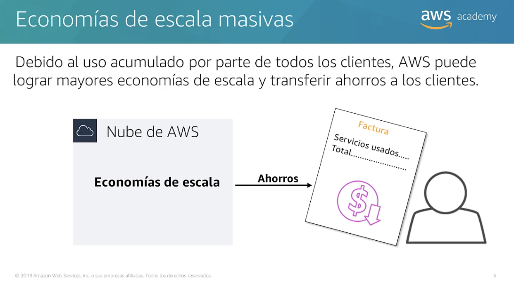
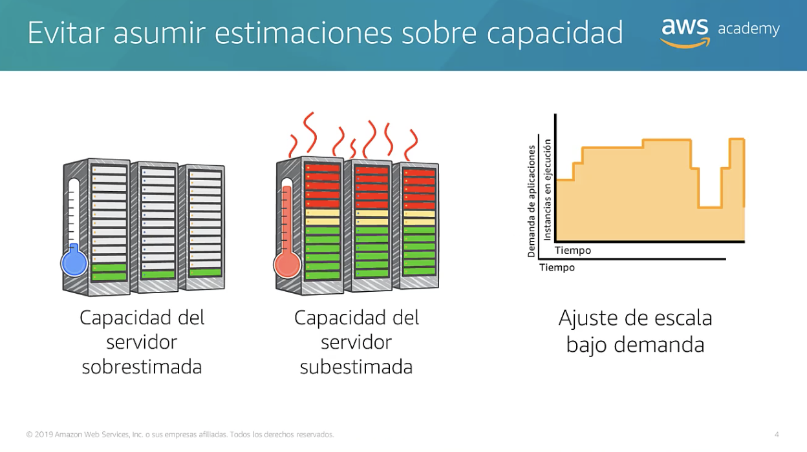
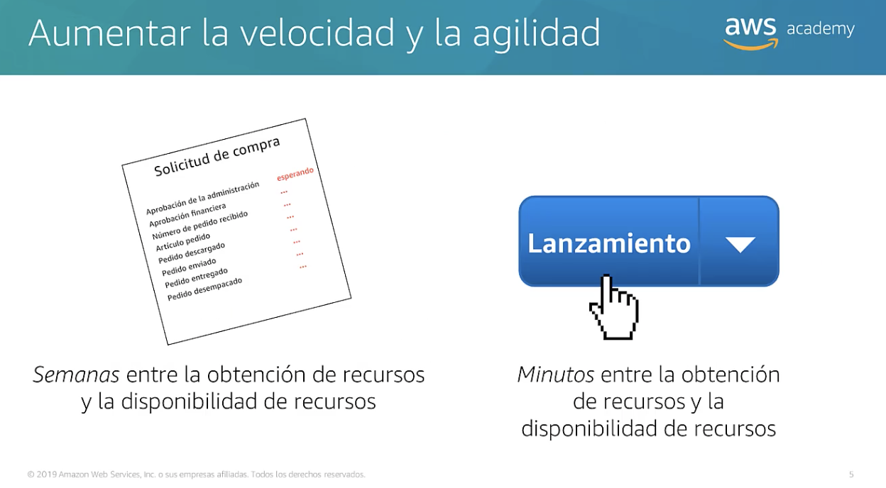
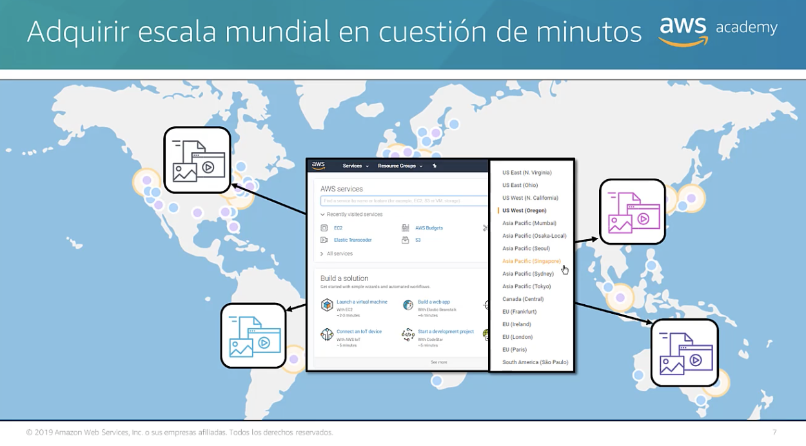

# 1. Fundamentos de computación en la nube

Clase: 15/10/2026

[Volver al índice](LEEME.md)

La computación en la nube permite acceder a recursos tecnológicos alojados en infraestructura remota. 

Tres conceptos principales:

* aprovisionamiento de recursos/servicios tecnológicos bajo un esquema *bajo demanda*   
* a *través de una red* (internet)   
* bajo un esquema *pago por uso*

## **Modelos de Servicio en la Nube:**

* **IaaS:** infraestructura como servicio: permite aprovisionar recursos tecnológicos, por ejemplo, un servidor virtual  
* **PaaS:** Plataforma como servicio, me otorga una plataforma de alguna solución tecnológica, por ejemplo me brinda herramientas como base de datos, API etc etc  
* **SaaS:** Software como servicio, por ejemplo el gmail, outlook, utilizado por usuarios finales

 

## **Modelos de Implementación.**

* **Nube Pública:** se despliega y yo puedo acceder a través de internet desde cualquier región geográfica  
* **Nube Privada:** (*soberanía de los datos:* hay políticas que los datos no salgan del país) se despliega y yo puedo acceder a través de INTRANET pero solo dentro de una región geográfica y de una empresa, un ejemplo AWS outposts  
* **Nube Híbrida:** mezcla de pública y privada dependiendo de los intereses del cliente   
* **Nube Comunitaria:** servidores, almacenamiento, aplicaciones y servicios— que son gestionados de manera conjunta por un grupo de usuarios con intereses alineados.

## **Ventajas:**

**CAPEX (Gasto de Capital - Capital Expenditure):**

Inversión en la adquisición o mejora de activos de largo plazo para expandir el negocio.

Se registra en el balance general y su costo se deprecia o amortizar gradualmente en varios años.

**OPEX (Gasto Operativo - Operational Expenditure):**

Costos continuos y recurrentes del día a día necesarios para mantener la operación en marcha.

Se deduce por completo en el estado de resultados dentro del mismo período fiscal en que ocurre.

### 1. Cambiar gastos de capital por gastos variables

 

### 2. Economías de escala

 

### 3. Obtener recursos bajo demanda

Obtener recursos bajo demanda

 

### 4. Aumentar la velocidad y la agilidad

 

### 5. Reducir la operación y el mantenimiento de centros de datos

 

### 6. Adquirir escala mundial en minutos

---

## Complemento — Curso AWS Academy (Módulos 1 y 3)

*(Apuntes del curso oficial de AWS Academy que complementan los fundamentos de computación en la nube).*

### 1. ¿Qué es un Servicio Web? (Módulo 1)

Es cualquier software disponible a través de Internet que se comunica mediante un formato estandarizado (como **XML** o **JSON**) para enviar solicitudes y recibir respuestas a través de una **API** (Interfaz de Programación de Aplicaciones).

### 2. Marco de Adopción de la Nube de AWS — AWS CAF (Módulo 1)

El **AWS Cloud Adoption Framework (CAF)** organiza la transición a la nube en **6 perspectivas** divididas en dos bloques:

| Bloque | Perspectiva | Enfoque principal |
| --- | --- | --- |
| **Capacidades empresariales** | **Negocio** | Alinear la tecnología con las necesidades y objetivos del negocio. |
| | **Personas (Gente)** | Formación técnica, cultura organizacional y dotación de personal. |
| | **Gobernanza** | Controlar riesgos, costos y cumplimiento de objetivos empresariales. |
| **Capacidades técnicas** | **Plataforma** | Diseñar, entender y comunicar la arquitectura de los sistemas en la nube. |
| | **Seguridad** | Cumplir los objetivos de confidencialidad, integridad y protección de datos. |
| | **Operaciones** | Definir cómo se ejecuta, monitorea y mantiene el negocio día a día. |

### 3. Infraestructura Global de AWS (Módulo 3)

*(Complementa la ventaja 6: «Adquirir escala mundial en minutos»).*

* **Región de AWS:** Área geográfica física e independiente del mundo (ej. `us-east-1`).
  * Cada región contiene varias Zonas de Disponibilidad.
  * Se comunican entre sí mediante una red troncal privada de fibra óptica de AWS.
  * **Importante:** La replicación de datos entre regiones **no es automática**; la controla y configura el cliente según sus necesidades.
* **Zona de Disponibilidad (AZ — Availability Zone):** Partición completamente aislada de la infraestructura dentro de una Región.
  * Está formada por **uno o más centros de datos discretos** interconectados con enlaces privados de alta velocidad y baja latencia.
  * Están diseñadas para **aislar fallos**: si una zona falla, las demás siguen operando.
  * *Recomendación:* Desplegar recursos y replicar datos en al menos **dos Zonas de Disponibilidad** para lograr alta resiliencia.
* **Centros de datos de AWS:** Instalaciones físicas seguras donde se almacenan y procesan los datos. Cuentan con energía, refrigeración, redes y conectividad redundantes.
* **Ubicaciones de borde (Edge Locations) y Amazon CloudFront:**
  * **Amazon CloudFront:** Red de entrega de contenido (**CDN**) que distribuye archivos, videos o páginas a usuarios finales con **baja latencia**.
  * **Ubicaciones de borde:** Cientos de puntos distribuidos en ciudades de todo el mundo (incluso en países donde no existe una Región de AWS) para guardar copias en caché cerca del usuario.
  * **Cachés de borde regionales:** Almacenan contenido de acceso menos frecuente para no tener que ir hasta el servidor de origen.

### 4. Características clave de la infraestructura en la nube (Módulo 3)

* **Elasticidad:** Capacidad de **aumentar o reducir automáticamente** los recursos de forma dinámica según la demanda en tiempo real.
* **Escalabilidad:** Capacidad de un sistema para **admitir el crecimiento** planificado sin perder rendimiento (agregando más servidores o potenciando los existentes).
* **Tolerancia a fallos (errores):** Capacidad de seguir funcionando sin interrupción aunque falle uno de sus componentes internos, gracias a la **redundancia integrada**.
* **Alta disponibilidad:** Garantía de que el sistema permanezca operativo y accesible (cerca del 24/7) con un tiempo de inactividad mínimo ante cualquier circunstancia.
