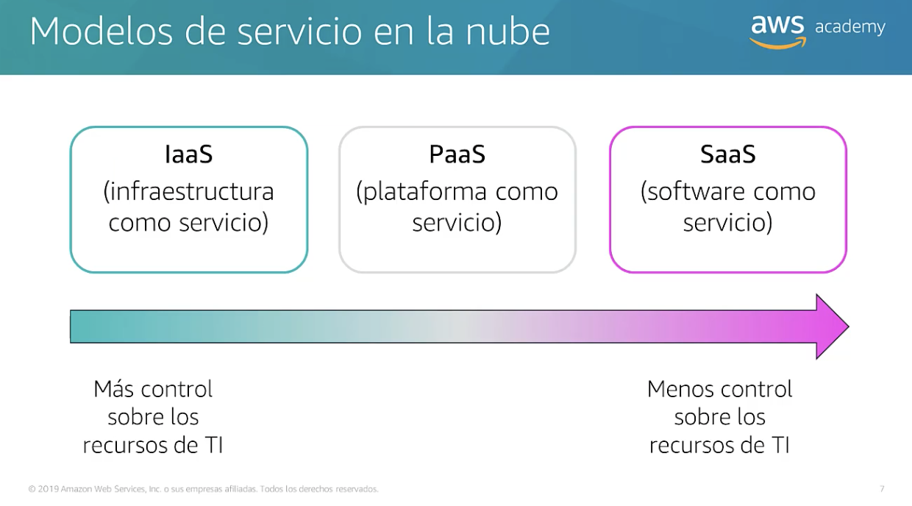
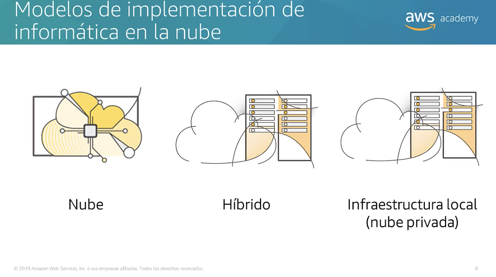
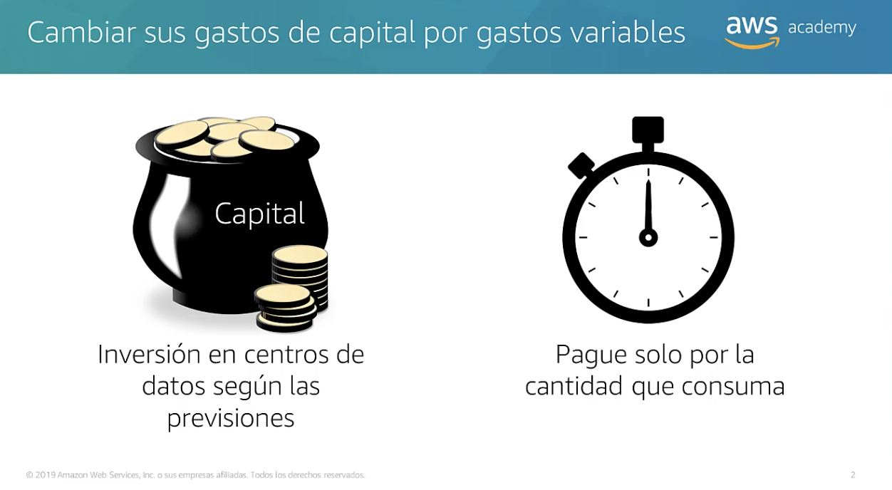
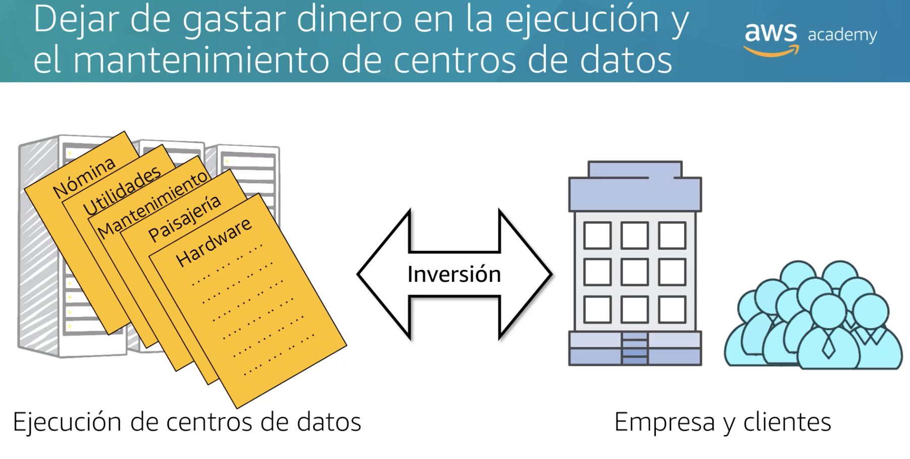

# 1. Fundamentos de computación en la nube

Clase: 15/10/2026

[Volver al índice](LEEME.md)

La computación en la nube permite acceder a recursos tecnológicos alojados en infraestructura remota. 

Tres conceptos principales:

* aprovisionamiento de recursos/servicios tecnológicos bajo un esquema *bajo demanda*   
* a *través de una red* (internet)   
* bajo un esquema *pago por uso*

## **Modelos de Servicio en la Nube:**

* **IaaS:** infraestructura como servicio: permite aprovisionar recursos tecnológicos, por ejemplo, un servidor virtual  
* **PaaS:** Plataforma como servicio, me otorga una plataforma de alguna solución tecnológica, por ejemplo me brinda herramientas como base de datos, API etc etc  
* **SaaS:** Software como servicio, por ejemplo el gmail, outlook, utilizado por usuarios finales

 

## **Modelos de Implementación.**

* **Nube Pública:** se despliega y yo puedo acceder a través de internet desde cualquier región geográfica  
* **Nube Privada:** (*soberanía de los datos:* hay políticas que los datos no salgan del país) se despliega y yo puedo acceder a través de INTRANET pero solo dentro de una región geográfica y de una empresa, un ejemplo AWS outposts  
* **Nube Híbrida:** mezcla de pública y privada dependiendo de los intereses del cliente   
* **Nube Comunitaria:** servidores, almacenamiento, aplicaciones y servicios— que son gestionados de manera conjunta por un grupo de usuarios con intereses alineados.

## **Ventajas:**

**CAPEX (Gasto de Capital - Capital Expenditure):**

Inversión en la adquisición o mejora de activos de largo plazo para expandir el negocio.

Se registra en el balance general y su costo se deprecia o amortizar gradualmente en varios años.

**OPEX (Gasto Operativo - Operational Expenditure):**

Costos continuos y recurrentes del día a día necesarios para mantener la operación en marcha.

Se deduce por completo en el estado de resultados dentro del mismo período fiscal en que ocurre.

### 1. Cambiar gastos de capital por gastos variables

 

### 2. Economías de escala

 

### 3. Obtener recursos bajo demanda

Obtener recursos bajo demanda

 

### 4. Aumentar la velocidad y la agilidad

 

### 5. Reducir la operación y el mantenimiento de centros de datos

 

### 6. Adquirir escala mundial en minutos

