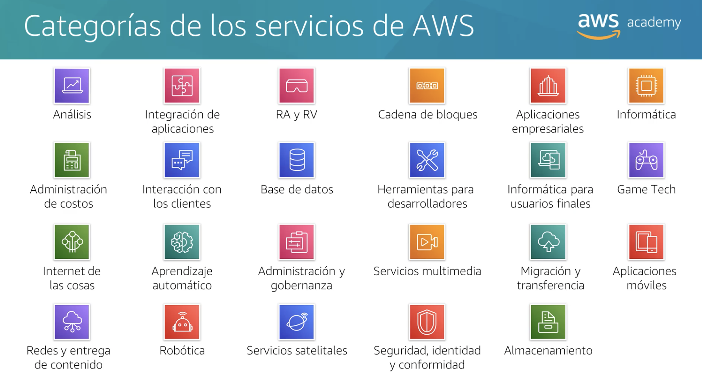
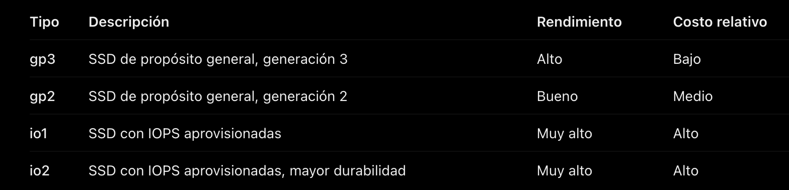

# 2. Servicios de AWS y Amazon EC2

Clase: 15/10/2026

[Volver al índice](LEEME.md)

## Categorías:

 

### Categoría Informática

Un ejemplo

**EC2 (Amazon Elastic Compute Cloud):** Servicio de computación en la nube que permite crear y administrar **servidores virtuales (llamados instancias)** bajo demanda con capacidad de cómputo escalable.

* **Nombre completo:** Amazon Elastic Compute Cloud.

* **Función principal:** Permite aprovisionar máquinas virtuales en minutos con la configuración que elijas de CPU, memoria RAM, almacenamiento y sistema operativo (Linux, Windows, etc.).

* **Elasticidad:** Puedes aumentar o reducir la potencia y cantidad de servidores según el tráfico o la demanda de tu aplicación.

* **Modelo de cobro:** Pago por uso (por segundo o por hora), convirtiendo los costos de infraestructura física (CAPEX) en gastos operativos variables (OPEX).

**Los AMIs (Amazon Machine Image):** son imágenes de máquina virtual preconfiguradas que incluyen el sistema operativo y el software necesario para lanzar instancias en la nube. Sirven como plantillas reutilizables para desplegar servidores idénticos de forma rápida y consistente.

**Instancias:** Son entornos virtuales o físicos donde se ejecutan las cargas de trabajo, definidos por la conformación de la familia (tipo de hardware) y el tamaño (capacidad de recursos).  

La conformación determina cuántos recursos (CPU, memoria) se asignan según la familia y el tamaño elegido.

**Familia:** Define el tipo de procesador y la cantidad de memoria que tendrá la instancia, agrupando configuraciones según el caso de uso (cómputo, memoria, propósito general).  

Cada familia ofrece perfiles específicos de CPU y RAM para optimizar rendimiento y costo.

**Pares de claves:** Son el mecanismo de autenticación basado en criptografía asimétrica, donde se crean una llave pública y una privada para acceder a las instancias.  

La llave pública se instala en la instancia y la privada la guarda el usuario para autenticarse de forma segura sin contraseña.

**GP e IO — aclaración:** En el apartado de almacenamiento, gp2/gp3 e io1/io2 son tipos de volúmenes EBS, no familias de instancias EC2.  

Los volúmenes de propósito general sirven para cargas variadas; los de IOPS aprovisionadas se orientan a cargas que requieren rendimiento de entrada/salida consistente.

