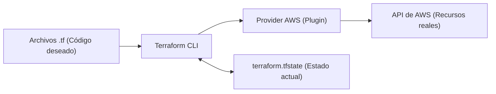
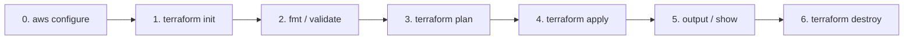

# 6. Infraestructura como código con Terraform

Clase: 05/11/2026

Última actualización: 2026-11-26

[Volver al índice](LEEME.md)

**Terraform** es una herramienta de código abierto de **Infraestructura como Código (IaC)** creada por HashiCorp. Permite definir, crear, actualizar y eliminar (CRUD) recursos en la nube mediante archivos de configuración (extensión `.tf`, normalmente con `main.tf` como archivo principal) de manera **declarativa**: defines tus intenciones (el *estado deseado*), no el paso a paso manual.

---

## 1. ¿Cómo funciona internamente?

En lugar de entrar a la consola web de AWS y hacer clic para crear servidores o firewalls, escribes archivos `.tf` en lenguaje **HCL** (*HashiCorp Configuration Language*). Terraform se comunica con las APIs de AWS mediante un plugin llamado **Provider** y registra todo lo que crea en un **archivo de estado**.



### Archivos especiales que genera Terraform

| Archivo / Carpeta | ¿Para qué sirve? | ¿Se sube a Git? |
| :--- | :--- | :--- |
| `*.tf` (`main.tf`, `variable.tf`, `outputs.tf`) | Código fuente HCL. Terraform lee **todos** los `.tf` del directorio como un único conjunto. | **Sí** |
| `.terraform/` | Carpeta oculta donde `terraform init` descarga el plugin del proveedor (ej. `hashicorp/aws`). | **No** |
| `.terraform.lock.hcl` | Archivo candado que fija la versión exacta del proveedor para despliegues reproducibles. | **Sí** (recomendado) |
| `terraform.tfstate` | **Archivo de estado.** Mapea tu código con los recursos reales en AWS (IDs, IPs, etc.). Permite saber qué actualizar o destruir. | **No** (puede contener datos sensibles) |
| `terraform.tfstate.backup` | Respaldo automático del estado inmediatamente anterior al último cambio. | **No** |

---

## 2. Anatomía del código HCL (Bloques fundamentales)

### 2.1 Bloque `provider` (Proveedor)
Define **con qué nube o plataforma** se conecta Terraform y en qué región operará.

```hcl
provider "aws" {
  region = "us-east-1"
}
```

- `"aws"`: nombre del proveedor oficial de Amazon Web Services.
- `region`: región geográfica de despliegue (`us-east-1` = Norte de Virginia).

### 2.2 Bloque `resource` (Recurso)
Es el bloque principal. Cada `resource` declara **un objeto real de infraestructura** en AWS (una instancia EC2, un Security Group, una regla de red, etc.).

```hcl
resource "<TIPO_DE_RECURSO>" "<NOMBRE_LOCAL>" {
  argumento_1 = "valor_1"
  argumento_2 = "valor_2"
}
```

Es clave distinguir **tres nombres distintos**:

1. **Tipo de recurso (`<TIPO_DE_RECURSO>`):** Definido por el proveedor AWS (no se puede inventar). Indica *qué servicio de AWS* se creará (`aws_instance`, `aws_security_group`, etc.).
2. **Nombre local (`<NOMBRE_LOCAL>`):** Lo eliges libremente. Solo existe **dentro de Terraform** para referenciar el recurso desde otros bloques (ej. `mi_instancia`, `mi-sg`).
3. **Nombre en AWS (`name` o `tags.Name`):** Es el argumento interno que define cómo aparecerá el recurso en la consola web de AWS.

#### Tipos de `resource` usados en los talleres de clase

| Tipo de recurso | Servicio AWS | ¿Para qué sirve? |
| :--- | :--- | :--- |
| `aws_security_group` | EC2 / VPC | Crea un firewall virtual que agrupa reglas de tráfico entrante y saliente. |
| `aws_vpc_security_group_ingress_rule` | EC2 / VPC | Crea una **regla de entrada** desacoplada y la vincula a un Security Group (práctica recomendada por AWS). |
| `aws_vpc_security_group_egress_rule` | EC2 / VPC | Crea una **regla de salida** desacoplada y la vincula a un Security Group. |
| `aws_instance` | EC2 | Aprovisiona una máquina virtual (instancia EC2) con AMI, tamaño, llave SSH y red. |

### 2.3 Bloque `variable` (Variables de entrada)
Permite **parametrizar** el proyecto para evitar valores fijos (*hardcoded*) en `main.tf` y reutilizar la misma infraestructura cambiando solo parámetros.

```hcl
variable "cantidad_instancias" {
  description = "Cantidad de instancias"
  type        = number
  default     = 2
}
```

| Campo | Obligatorio | ¿Para qué sirve? |
| :--- | :--- | :--- |
| `"nombre"` | Sí | Identificador de la variable. Se lee en el código como `var.<nombre>` (ej. `var.cantidad_instancias`). |
| `description` | No (recomendado) | Documenta qué valor representa la variable. |
| `type` | No (recomendado) | Restringe el tipo de dato: `string`, `number`, `bool`, `list(...)`, `map(...)`, etc. |
| `default` | No | Valor por defecto. Si se omite, Terraform lo pedirá por terminal al ejecutar `plan` o `apply`. |

> **Tip:** Puedes sobrescribir cualquier variable desde la terminal sin editar archivos: `terraform apply -var="cantidad_instancias=3"`.

### 2.4 Bloque `output` (Salidas)
Expone en la terminal valores generados por AWS al terminar el despliegue (IDs, IPs públicas, zonas de disponibilidad) sin tener que buscarlos manualmente en la consola web.

```hcl
output "ip_publica_instancias" {
  description = "Direcciones IP públicas de las instancias creadas"
  value       = aws_instance.mi_instancia-efs[*].public_ip
}
```

| Campo | Obligatorio | ¿Para qué sirve? |
| :--- | :--- | :--- |
| `"nombre"` | Sí | Nombre con el que se imprimirá la salida en terminal. |
| `description` | No | Explica qué información devuelve la salida. |
| `value` | Sí | Atributo o expresión de los recursos que se quiere mostrar. |

### 2.5 Expresiones y conceptos clave en HCL

- **Referencias y dependencias implícitas:** Al escribir `vpc_security_group_ids = [aws_security_group.mi-sg.id]`, Terraform detecta automáticamente que **primero debe crear el Security Group** y luego la instancia EC2, sin definir el orden a mano.
- **Meta-argumento `count` e interpolación `${...}`:** Con `count = var.cantidad_instancias`, Terraform crea *N* copias del recurso usando un índice `count.index` que inicia en `0`. Al escribir `"Mi instancia EFS - ${count.index + 1}"`, genera nombres numerados (`1`, `2`, ...).
- **Expresión *Splat* (`[*]`):** Cuando un recurso usa `count`, se convierte en una lista. La sintaxis `aws_instance.mi_instancia-efs[*].public_ip` recorre todas las instancias y extrae una lista con el atributo `public_ip` de cada una.
- **Funciones nativas (`length()`):** `length(aws_instance.mi_instancia-efs)` devuelve cuántos elementos fueron creados en esa lista de instancias.

---

## 3. Guía de comandos en terminal (Ciclo de vida)

Todos los comandos de Terraform se ejecutan **dentro de la carpeta del proyecto** que contiene los archivos `.tf`.



1. **Configurar credenciales de AWS**
   ```bash
   aws configure
   ```
   - Guarda `AWS Access Key ID`, `AWS Secret Access Key`, región (`us-east-1`) y formato (`json`). En AWS Academy / Learner Lab recuerda incluir también el `aws_session_token` en `~/.aws/credentials`.

2. **Inicializar el proyecto (primera vez o al agregar proveedores)**
   ```bash
   terraform init
   ```
   - Descarga el plugin del proveedor AWS en `.terraform/` y crea `.terraform.lock.hcl`.

3. **Formatear y validar sintaxis (sin tocar AWS)**
   ```bash
   terraform fmt
   terraform validate
   ```
   - `fmt` indenta y ordena el código automáticamente; `validate` verifica que la sintaxis HCL y las referencias sean válidas.

4. **Previsualizar el plan de ejecución**
   ```bash
   terraform plan
   ```
   - Compara tus `.tf` contra `terraform.tfstate` y AWS. Símbolos del plan:
     - `+` (**create**): se creará un recurso nuevo.
     - `~` (**update in-place**): se modificará sin destruirlo.
     - `-` (**destroy**): se eliminará.
     - `-/+` (**replace**): se destruirá y recreará (ej. al cambiar la AMI de una EC2).

5. **Aplicar los cambios en AWS**
   ```bash
   terraform apply
   ```
   - Muestra el plan, pide confirmación (`yes`), crea los recursos en AWS, actualiza `terraform.tfstate` e imprime los `outputs`. (Con `-auto-approve` omite la confirmación manual).

6. **Inspeccionar el despliegue actual**
   ```bash
   terraform output
   terraform state list
   terraform show
   ```
   - `output` vuelve a mostrar las salidas (como IPs públicas); `state list` enumera los recursos gestionados; `show` muestra todos los atributos guardados en el estado.

7. **Destruir la infraestructura al terminar el laboratorio**
   ```bash
   terraform destroy
   ```
   - Elimina todos los recursos registrados en el estado respetando el orden inverso de dependencias. Es fundamental ejecutarlo al terminar cada práctica para evitar costos o consumo de créditos.

---

## Conceptos relacionados

- [Talleres prácticos de Terraform: Taller 8 (EC2) y Taller 12 (EC2 + SG EFS)](10-talleres-terraform.md).
- [Redes y seguridad: VPC y Security Groups](03-redes-seguridad.md).
- [Consola, AWS CLI y SDK](05-herramientas-aws.md).
