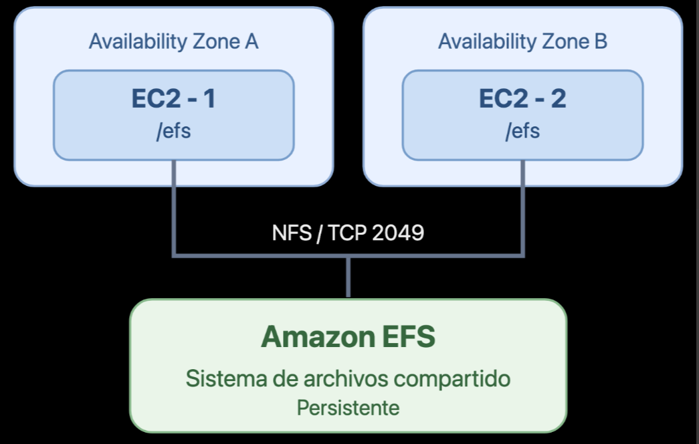

# 7. Almacenamiento: EBS, EFS y NFS

Clase: 10/11/2026

[Volver al índice](LEEME.md)

Categorías de Almacenamiento:

Persistente: Es un almacenamiento que perdura en el tiempo

* Storage EC2:  
  * Amazon **EBS (Elastic Block Store)**, servicio de almacenamiento persistente por bloques independientes que trabajan en conjunto  
    * **gp3 o gp2** (propósito general; gp3 corresponde a la tercera generación): se usa para cualquier cosa, para ámbitos generales  
    * **io1 e io2** (input-output de primera o segunda generación): tipos de volúmenes de alto rendimiento por ejemplo para instalar recursos como base de datos ejemplo un CRUD, optimizada para la escritura y lectura  
  * Amazon **EFS (Elastic File System)**, servicio administrado, permite  varias instancias almacenen de manera compartida sobre este sistema de almacenamiento de red a través del protocolo NFS.  
    * **NFS** (**Network File System** o *Sistema de Archivos de Red*) es un protocolo distribuido de nivel de aplicación basado en la arquitectura cliente-servidor, que permite a un equipo acceder, leer y escribir archivos y directorios remotos a través de una red IP como si estuvieran almacenados en su propio disco local.   
    *   
    * Network es un punto de acceso a cada una de las zonas de disponibilidad

No Persistente: (Efímero) es volátil mientras el proceso está en ejecución existe y si se termina también se termina o borra ese almacenamiento 

Recuerda tenemos que montar un disco cuando colocamos un nuevo disco en el servidor

## Ampliación de clase — 2026-11-12

Última actualización: 2026-11-17

### EBS frente a EFS

| Aspecto | EBS | EFS |
| --- | --- | --- |
| Tipo | Almacenamiento en bloques. | Sistema de archivos compartido. |
| Uso en el taller | Volumen de 10 GiB de la instancia 1, montado en /disco2. | Mismo sistema de archivos montado en /efs1 de las dos instancias. |
| Preparación | Identificar el volumen; formatear solo si está vacío y sin sistema de archivos. | Instalar amazon-efs-utils y montar por red con TLS. |
| Acceso | Volumen dedicado en este ejercicio; Multi-Attach es una opción específica de io1/io2. | Varios clientes acceden a los mismos archivos mediante NFS. |

### NFS y archivos compartidos

NFS permite montar un sistema de archivos remoto como un directorio local. Para EFS, la conectividad NFS utiliza TCP 2049. Leer desde la segunda instancia el archivo escrito en la primera verifica acceso al mismo almacenamiento, no una copia sincronizada entre discos.

### Elasticidad y disponibilidad

EFS administra la infraestructura y ajusta el almacenamiento a los archivos guardados. La facturación puede incluir otros componentes además de capacidad. EFS Regional guarda datos en varias zonas de disponibilidad; EFS One Zone usa una sola. No todos los sistemas EFS tienen la misma distribución entre zonas.

[Ver taller completo](09-taller-ebs-efs.md).

Fuentes: [AWS: Multi-Attach de EBS](https://docs.aws.amazon.com/ebs/latest/userguide/ebs-volumes-multi.html), [AWS: destinos de montaje EFS](https://docs.aws.amazon.com/efs/latest/ug/accessing-fs.html).
