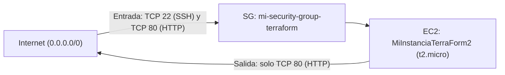
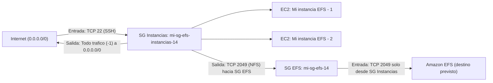

# 10. Talleres prácticos de Terraform (EC2 y EFS)

Última actualización: 2026-11-26

[Volver al índice](LEEME.md)

Análisis práctico del repositorio de código [Aryy234/cloud-u1-ps-ae](https://github.com/Aryy234/cloud-u1-ps-ae), mostrando la evolución real entre **`taller8-ae2`** (despliegue básico en un solo archivo) y **`taller12-efs-ae`** (arquitectura modular con variables, outputs, `count` y reglas de red entre Security Groups para Amazon EFS).

> Si necesitas repasar qué son `provider`, `resource`, `variable`, `output` o los comandos de terminal, consulta primero el tema [6. Infraestructura como código con Terraform](06-terraform.md).

---

## 1. Taller 8 (`taller8-ae2`): EC2 y Security Group básico

**Archivo:** `taller8-ae2/main.tf`
**Objetivo:** Primer despliegue en AWS con Terraform creando 1 instancia EC2 y 1 Security Group con reglas embebidas (*inline*) y valores fijos.



### A. Recurso `aws_security_group` — Nombre local: `mi-sg`

| Campo | Valor en el proyecto | ¿Para qué sirve? |
| :--- | :--- | :--- |
| `name` | `"mi-security-group-terraform"` | Nombre visible del Security Group en la consola de AWS. |
| `description` | `"grupo de seguridad para mi terraform"` | Descripción del propósito del grupo. |
| `vpc_id` | `"vpc-09ffffa328714b7dd"` | ID de la VPC donde se crea el Security Group. |
| `ingress` (SSH) | `from_port = 22`, `to_port = 22`, `protocol = "tcp"`, `cidr_blocks = ["0.0.0.0/0"]` | Permite conexiones SSH entrantes desde cualquier dirección IPv4. |
| `ingress` (HTTP) | `from_port = 80`, `to_port = 80`, `protocol = "tcp"`, `cidr_blocks = ["0.0.0.0/0"]` | Permite tráfico web HTTP entrante desde cualquier IPv4. |
| `egress` (HTTP) | `from_port = 80`, `to_port = 80`, `protocol = "tcp"`, `cidr_blocks = ["0.0.0.0/0"]` | Permite tráfico saliente únicamente por el puerto 80 TCP. |

> **Observación técnica (`egress` en Taller 8):** Al permitir salida solo por el puerto `80`, la instancia no podría resolver DNS (puerto `53`) ni descargar paquetes por HTTPS (puerto `443`). En Terraform, a diferencia de la consola de AWS, no se crea automáticamente la regla de "toda salida" cuando defines `egress` manualmente. Esto se corrige en el Taller 12.

### B. Recurso `aws_instance` — Nombre local: `mi_instancia`

| Campo | Valor en el proyecto | ¿Para qué sirve? |
| :--- | :--- | :--- |
| `ami` | `"ami-0c230065b91270bc6"` | Imagen del sistema operativo (AMI) que usará el servidor. |
| `instance_type` | `"t2.micro"` | Capacidad de hardware virtual (vCPU y RAM). |
| `key_name` | `"mi-primera-llaves-ae"` | Nombre del par de llaves SSH registrado en AWS para iniciar sesión. |
| `tags` | `{ Name = "MiInstanciaTerraForm2" }` | Etiqueta que asigna el nombre visible de la instancia en EC2. |
| `vpc_security_group_ids` | `[aws_security_group.mi-sg.id]` | Vincula el Security Group mediante una **referencia dinámica** (dependencia implícita). |

---

## 2. Taller 12 (`taller12-efs-ae`): Múltiples EC2 y red para Amazon EFS

**Archivos:** `taller12-efs-ae/main.tf`, `variable.tf` y `outputs.tf`
**Objetivo:** Aplicar buenas prácticas separando archivos, parametrizando con variables, desplegando 2 instancias con `count`, devolviendo outputs y configurando dos Security Groups comunicados por el puerto NFS `2049`.

> **Alcance actual del código:** `taller12-efs-ae` crea los Security Groups (para EC2 y para EFS) y las 2 instancias EC2, pero todavía no declara el recurso de almacenamiento EFS (`aws_efs_file_system` ni `aws_efs_mount_target`). Si el EFS se crea aparte en consola AWS, se asocia al Security Group `mi-security-group-terraform-efs` generado aquí.



### A. Archivo `variable.tf` (Parámetros de entrada)

| Variable | Tipo (`type`) | Valor por defecto (`default`) | Uso en `main.tf` |
| :--- | :--- | :--- | :--- |
| `region` | `string` | `"us-east-1"` | `provider "aws"` (`region`) |
| `ami_id` | `string` | `"ami-0c230065b91270bc6"` | `aws_instance` (`ami`) |
| `tipo_instancia` | `string` | `"t2.micro"` | `aws_instance` (`instance_type`) |
| `nombre_llave` | `string` | `"mi-primera-llaves-ae"` | `aws_instance` (`key_name`) |
| `cantidad_instancias` | `number` | `2` | `aws_instance` (`count`) |

### B. Archivo `main.tf` (Security Groups, Reglas e Instancias)

#### 1. Security Groups base (sin reglas *inline*)
- **`aws_security_group.mi-sg-efs-instancias-14`** (`name = "mi-security-group-terraform-efs-instancias"`): protege las instancias EC2 dentro de `vpc-09ffffa328714b7dd`.
- **`aws_security_group.mi-sg-efs-14`** (`name = "mi-security-group-terraform-efs"`): protege los *Mount Targets* de EFS en la misma VPC.

#### 2. Reglas independientes (`aws_vpc_security_group_*_rule`)

| Recurso | Tipo | Configuración y propósito |
| :--- | :--- | :--- |
| `entrada_ssh_instancias` | `ingress_rule` | Asociada al SG de instancias. Abre `tcp` puerto `22` desde `cidr_ipv4 = "0.0.0.0/0"` para acceso SSH. |
| `salida_efs` | `egress_rule` | Asociada al SG de instancias. Permite salida `tcp` puerto `2049` (NFS) cuyo destino es `referenced_security_group_id = aws_security_group.mi-sg-efs-14.id`. |
| `salida_internet` | `egress_rule` | Asociada al SG de instancias. Permite salida libre a Internet (`ip_protocol = "-1"`, todos los protocolos y puertos, hacia `0.0.0.0/0`) para instalar `amazon-efs-utils` y actualizaciones. |
| `entrada_efs` | `ingress_rule` | Asociada al SG de EFS. Permite entrada `tcp` puerto `2049` **únicamente** desde recursos que pertenezcan al SG de instancias (`referenced_security_group_id = aws_security_group.mi-sg-efs-instancias-14.id`). |

> **¿Por qué el SG de EFS no necesita reglas de salida?** Porque los Security Groups de AWS son **stateful**: al autorizar la entrada desde las EC2 por el puerto `2049`, el tráfico de respuesta queda permitido automáticamente.

#### 3. Instancias EC2 (`aws_instance.mi_instancia-efs`)

| Campo | Valor en el proyecto | ¿Para qué sirve? |
| :--- | :--- | :--- |
| `ami` | `var.ami_id` | Sistema operativo parametrizado. |
| `instance_type` | `var.tipo_instancia` | Tipo de servidor parametrizado (`t2.micro`). |
| `key_name` | `var.nombre_llave` | Llave SSH parametrizada. |
| `count` | `var.cantidad_instancias` | Crea `2` instancias idénticas con índices `0` y `1`. |
| `tags` | `{ Name = "Mi instancia EFS - ${count.index + 1}" }` | Interpola el índice para nombrarlas `Mi instancia EFS - 1` y `Mi instancia EFS - 2`. |
| `vpc_security_group_ids` | `[aws_security_group.mi-sg-efs-instancias-14.id]` | Asigna el Security Group de instancias a cada máquina. |

### C. Archivo `outputs.tf` (Salidas en terminal)

| Output | Expresión (`value`) | Resultado devuelto |
| :--- | :--- | :--- |
| `ids_instancias` | `aws_instance.mi_instancia-efs[*].id` | Lista con los IDs de todas las instancias creadas. |
| `cantidad_instancias` | `length(aws_instance.mi_instancia-efs)` | Total numérico de instancias (`2`). |
| `ip_publica_instancias` | `aws_instance.mi_instancia-efs[*].public_ip` | Lista con las IPs públicas para conectarte por SSH. |
| `zona_disponibilidad` | `aws_instance.mi_instancia-efs[*].availability_zone` | Lista con la zona de disponibilidad (AZ) de cada instancia. |

---

## 3. Comparativa Evolutiva: Taller 8 vs. Taller 12

| Aspecto | Taller 8 (`taller8-ae2`) | Taller 12 (`taller12-efs-ae`) | Mejora lograda |
| :--- | :--- | :--- | :--- |
| **Organización** | Todo en `main.tf` | `main.tf`, `variable.tf`, `outputs.tf` | Separación clara de responsabilidades. |
| **Parametrización** | Valores fijos (*hardcoded*) | Variables tipadas con valores `default` | Reutilización sin modificar `main.tf`. |
| **Reglas de SG** | Bloques *inline* `ingress`/`egress` | Recursos `aws_vpc_security_group_*_rule` | Evita recreaciones accidentales y sigue el estándar actual de AWS. |
| **Seguridad entre servicios** | Solo CIDR `0.0.0.0/0` | Referencia entre Security Groups (`referenced_security_group_id`) | Principio de mínimo privilegio entre EC2 y EFS. |
| **Salida a Internet** | Limitada al puerto 80 TCP | Todo el tráfico (`ip_protocol = "-1"`) | Permite DNS, HTTPS e instalación de paquetes. |
| **Escalabilidad** | 1 instancia fija | Múltiples instancias con `count` y `${count.index + 1}` | Escalar consiste en cambiar un número. |
| **Visibilidad** | Sin `outputs` | 4 `outputs` con `[*]` y `length()` | IPs y metadatos directos en terminal. |

---

## 4. Buenas prácticas y mejoras pendientes del repositorio

1. **No versionar archivos sensibles en Git:**
   - Nunca subir archivos `.pem` (llaves privadas) ni `terraform.tfstate` / `terraform.tfstate.backup` a GitHub.
   - Si ya fueron rastreados antes de actualizar `.gitignore`, se retiran del índice sin borrarlos localmente con:
     ```bash
     git rm --cached taller12-efs-ae/terraform.tfstate taller12-efs-ae/terraform.tfstate.backup
     git rm --cached mi-primera-llaves-ae.pem
     ```
2. **Parametrizar `vpc_id` y convención de nombres:**
   - Mover `vpc_id = "vpc-09ffffa328714b7dd"` a una variable (o consultar la VPC por defecto con `data "aws_vpc" "default" { default = true }`).
   - Por convención estándar de Terraform, el archivo de variables suele nombrarse en plural (`variables.tf`).
3. **Seguridad SSH en producción:**
   - En laboratorios se suele abrir SSH a `0.0.0.0/0`, pero en entornos reales debe restringirse a tu IP pública (`<TU_IP>/32`) o usar AWS Systems Manager Session Manager.
4. **Nota sobre `salida_efs` vs. `salida_internet`:**
   - Como `salida_internet` permite `ip_protocol = "-1"` hacia `0.0.0.0/0`, ya cubre el tráfico saliente al puerto `2049`. Conservar `salida_efs` es útil a nivel didáctico y protege la arquitectura si luego restringes la salida a Internet.
5. **Siguiente paso lógico en Terraform para EFS:**
   - Declarar `aws_efs_file_system` y `aws_efs_mount_target` (asociándole `aws_security_group.mi-sg-efs-14.id`) para automatizar también el sistema de archivos sin pasar por la consola web.

---

## Conceptos relacionados

- [6. Infraestructura como código con Terraform (teoría y comandos)](06-terraform.md).
- [3. Redes y seguridad: VPC y Security Groups](03-redes-seguridad.md).
- [9. Taller de almacenamiento EBS y EFS (montaje Linux paso a paso)](09-taller-ebs-efs.md).
- [Repositorio de código en GitHub (cloud-u1-ps-ae)](https://github.com/Aryy234/cloud-u1-ps-ae).
