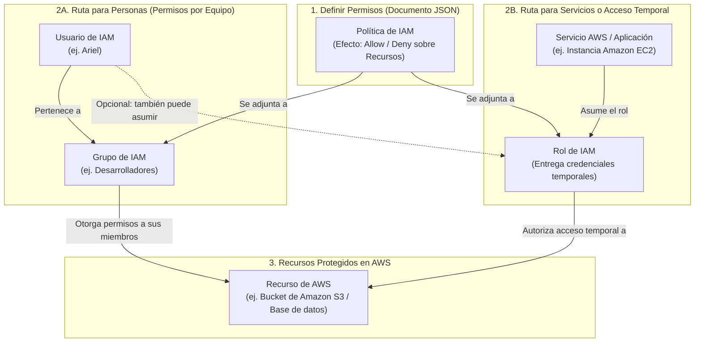

# 11. Seguridad, IAM y Gobernanza en AWS (Curso AWS — Módulos 2 y 4)

Fecha de apuntes: 2026-11-21

[Volver al índice](LEEME.md)

> **Paréntesis:** Estos apuntes pertenecen a los **Módulos 2 y 4 del curso de AWS (AWS Academy: Seguridad en la nube de AWS y Gobernanza)** y complementan los temas de [3. Redes y seguridad: VPC y Security Groups](03-redes-seguridad.md) y [5. Consola, AWS CLI y SDK](05-herramientas-aws.md).

---

## 1. Modelo de Responsabilidad Compartida de AWS

La seguridad y el cumplimiento se dividen entre AWS y el cliente:

| Responsable | Lema oficial | Qué administra y protege |
| --- | --- | --- |
| **El Cliente** | Seguridad **«EN»** la nube (*Dentro de la nube*) | - **Datos del cliente** y su **cifrado** (en reposo y en tránsito). - Aplicaciones, gestión de usuarios y permisos (**IAM**). - Configuración del **Sistema Operativo**, parches y actualizaciones (ej. en EC2). - Configuración de red y firewalls (**Security Groups**, Network ACLs). |
| **AWS** | Seguridad **«DE»** la nube (*De la infraestructura base*) | - **Hardware físico:** servidores, discos, cables y mantenimiento físico. - **Infraestructura global:** Regiones, Zonas de Disponibilidad, Centros de datos y Ubicaciones de borde. - **Capa de software de virtualización** subyacente (Cómputo, Almacenamiento, Bases de datos y Redes físicas). |

---

## 2. AWS Identity and Access Management (IAM)

**Definición:** Servicio gratuito que permite **administrar de forma segura el acceso** a los servicios y recursos de AWS.
* **Recurso:** Cualquier objeto o entidad dentro de una cuenta con el que se puede trabajar (ej. una instancia EC2, un bucket de S3 o un volumen EBS).
* **¿Qué controla IAM?**
  1. **Quién** puede acceder (*Autenticación*).
  2. **A qué** recursos puede acceder y qué acciones puede realizar (*Autorización*).
  3. **Cómo** puede obtener acceso (Consola web o Programación CLI/SDK).

### A. Componentes principales de IAM

1. **Usuario de IAM (Persona o aplicación):** Identidad permanente que representa a una persona o servicio que interactúa con AWS.
   * Por defecto, un usuario recién creado **no tiene ningún permiso**.
   * Puede autenticarse por **Consola** (cuenta + usuario + contraseña + MFA) o por **Programación** (*Access Key ID* + *Secret Access Key* para CLI/SDK).
2. **Grupo de IAM:** Colección de **usuarios de IAM** que necesitan los mismos permisos (ej. grupo `Desarrolladores` o `Administradores`).
   * Un usuario puede pertenecer a **varios grupos** (o a ninguno).
   * **No existe** un grupo predeterminado.
   * Los grupos **no pueden estar anidados** (un grupo solo contiene usuarios, nunca otros grupos ni roles).
3. **Rol de IAM:** Identidad con permisos específicos que **no pertenece a una sola persona** ni tiene contraseñas o claves permanentes.
   * Está diseñado para que lo **asuma temporalmente** un usuario, una aplicación o un **servicio de AWS** (por ejemplo, una instancia EC2 que necesita permiso para guardar archivos en S3).
   * Entrega **credenciales temporales** de seguridad.
4. **Política de IAM:** Documento escrito en formato **JSON** que define explícitamente qué acciones están **permitidas (`Allow`)** o **denegadas (`Deny`)** sobre qué recursos.

---

### B. Aclaración de tus consultas sobre Políticas, Entidades y Permisos

*(Resolución de las dudas anotadas en el Módulo 4).*

* **1. ¿Qué es una «Entidad» en IAM?**
  Son los objetos de identidad de IAM a los que puedes adjuntar una política de permisos: un **Usuario de IAM**, un **Grupo de IAM** o un **Rol de IAM**.
* **2. Tipos de Políticas en IAM:**
  * **Políticas basadas en identidad:** Se adjuntan a un **Usuario, Grupo o Rol**. Indican qué puede hacer esa identidad (ej. *«Este grupo puede reiniciar instancias EC2»*). Una misma política se puede asociar a varias entidades, y una entidad puede tener varias políticas.
  * **Políticas basadas en recursos:** Se adjuntan directamente al **recurso** (el ejemplo más común es una *Bucket Policy* en un **bucket de Amazon S3**). Indican a quién le permite el recurso entrar (ej. *«Este bucket S3 permite que la cuenta X lea sus archivos»*).
* **3. Evaluación de permisos: Denegación implícita vs. Autorización vs. Denegación explícita:**
  1. **Denegación implícita (por defecto):** Todo está **denegado** al principio si no hay ninguna política que lo autorice.
  2. **Autorización explícita (`Allow`):** Una política concede permiso para hacer la acción. Si no hay ningún `Deny`, la acción se permite.
  3. **Denegación explícita (`Deny`):** Una política prohíbe expresamente la acción. **La denegación explícita SIEMPRE gana** sobre cualquier permiso `Allow`.
* **Práctica recomendada:** Aplicar siempre el **Principio de mínimo privilegio** (otorgar únicamente los permisos estrictamente necesarios para realizar una tarea).

---

### C. Corrección de tu flujo jerárquico y Diagrama de IAM

> **Análisis de la nota que escribiste en tus apuntes:**
> Escribiste: *«1. Crear política -> 2. Asociar política a un rol -> 3. Crear grupo y ese grupo asociarlo al rol -> 4. Crear usuario y asignarlo al grupo»*.
>
> **¿Qué estaba bien y qué debemos corregir?**
> * **Lo correcto:** Siempre se empieza definiendo la **Política JSON** (qué permisos damos) y luego los **Usuarios** se meten dentro de **Grupos**.
> * **La corrección clave:** En AWS **un Grupo NO se asocia directamente a un Rol**. Las **Políticas** se adjuntan directamente al **Grupo** (para personas fijas) **O** se adjuntan a un **Rol** (para servicios como EC2 o accesos temporales).
>   * **Ruta 1 (Para personas / equipos):** Creas la **Política** → Creas el **Grupo** y le adjuntas la **Política** → Creas el **Usuario** y lo metes al **Grupo**.
>   * **Ruta 2 (Para servidores / aplicaciones o permisos temporales):** Creas la **Política** → Creas el **Rol** y le adjuntas la **Política** → El servicio (ej. una instancia **EC2**) o un usuario **asume el Rol** y recibe credenciales temporales.

#### Diagrama de flujo exacto: Cómo interactúan todos los componentes de IAM en AWS

---

### D. Usuario Raíz (Root User) y MFA

* **Usuario Raíz (*Root User*):** Se crea automáticamente al abrir la cuenta de AWS (con el correo y contraseña iniciales) y tiene **acceso total e ilimitado**.
* **Prácticas recomendadas obligatorias para el Usuario Raíz:**
  1. **NO usarlo** para las tareas cotidianas.
  2. **Eliminar las claves de acceso programáticas** (*Access Key ID* y *Secret Access Key*) del usuario raíz para evitar accesos ilimitados por código.
  3. **Activar MFA (Autenticación Multifactor):** Exige un segundo factor (código temporal desde una app o llave física) además de la contraseña.
  4. **Crear un usuario administrador en IAM** para trabajar en el día a día.
* **Tareas exclusivas del Usuario Raíz:** Cambiar o cancelar el plan de soporte de AWS, modificar los datos principales de la cuenta (correo raíz, nombre), cerrar la cuenta de AWS o restaurar permisos perdidos de un administrador de IAM.

*(Nota sobre tus apuntes: bajo el título de AWS KMS tenías anotados «tipos de acceso de usuario» y «prácticas recomendadas para proteger su cuenta»; esos dos puntos pertenecen a **AWS IAM**, por lo que quedaron integrados aquí).*

---

## 3. AWS Organizations y Políticas de Control de Servicios (SCP)

*(Integrado desde el Módulo 2 por su relación directa con la gobernanza y seguridad de cuentas).*

* **¿Qué es AWS Organizations?** Servicio que permite **consolidar múltiples cuentas de AWS** de una empresa y administrarlas de forma centralizada.
* **Beneficios principales:**
  * Facturación consolidada (*Consolidated Billing*) y descuentos por volumen combinados.
  * Agrupar cuentas en **Unidades Organizativas (OU)** y aplicarles políticas de seguridad centralizadas.
  * Automatizar la creación de nuevas cuentas mediante llamadas a la API.

### Los 4 pasos para configurar AWS Organizations *(Resolución de nota «Investigar»)*

1. **Paso 1 — Crear la organización:** Desde la cuenta principal (administradora) e invitar o crear las cuentas miembro de la empresa.
2. **Paso 2 — Crear las Unidades Organizativas (OU):** Agrupar las cuentas por departamento o entorno (ej. `OU-Producción`, `OU-Desarrollo`, `OU-Finanzas`).
3. **Paso 3 — Crear las Políticas de Control de Servicios (SCP):** Redactar los documentos de límites de permisos en formato JSON.
4. **Paso 4 — Adjuntar y probar las SCP:** Asignar las políticas a la raíz, a una **OU** o a una cuenta específica y verificar las restricciones.

### Políticas de Control de Servicios (SCP — *Service Control Policies*)

* Son políticas de **AWS Organizations** (con sintaxis JSON similar a IAM) que establecen el **límite máximo de permisos** (*guardrails*) para las cuentas o Unidades Organizativas (OU).
* **Regla de oro:** Una SCP **NO concede permisos por sí sola**. Solo define qué servicios o acciones están permitidos como tope en una cuenta; el usuario dentro de esa cuenta aún necesita que **IAM** le otorgue el permiso. (Si una SCP bloquea EC2 en una cuenta, ni siquiera el usuario Raíz o Administrador de esa cuenta podrá lanzar una EC2).

---

## 4. Servicios de Cifrado, Autenticación, Auditoría y Conformidad

| Servicio / Concepto | Función clave en AWS (Módulo 4) |
| --- | --- |
| **AWS KMS** (*Key Management Service*) | Crea y administra **claves criptográficas** para el **cifrado de datos en reposo** en tus servicios y aplicaciones. Utiliza módulos de seguridad de hardware (**HSM**) validados bajo el estándar **FIPS 140-2** y registra el uso de las claves en CloudTrail. |
| **Amazon Cognito** | Servicio para agregar **inicio de sesión, registro y control de acceso de usuarios finales** a tus **aplicaciones web y móviles**. Escala a millones de usuarios y soporta proveedores sociales (Google, Facebook, Amazon) y empresariales (SAML, Microsoft Active Directory). |
| **AWS Shield** | Protección administrada contra ataques **DDoS** (Denegación de Servicio Distribuido) con detección continua y mitigación automática para evitar caídas y latencia. |
| **AWS CloudTrail** *(Resolución de consulta)* | **«La cámara de seguridad de las API»:** Registra y audita **todas las llamadas a la API y acciones** realizadas en la cuenta (quién hizo qué, desde qué IP y a qué hora), ya sea desde la consola, CLI o SDK. Sus registros se pueden guardar en Amazon S3. |
| **AWS Config** | Evalúa, audita y monitorea el **historial de configuración de tus recursos** de AWS a lo largo del tiempo. Compara las configuraciones actuales contra las reglas deseadas para verificar el cumplimiento normativo. |
| **AWS Artifact** | Portal autoservicio bajo demanda que da acceso a los **informes de seguridad, auditoría y conformidad de AWS** (certificaciones ISO, reportes SOC, informes PCI-DSS del sector de tarjetas de pago). |
| **Programas de Conformidad de AWS** | Colaboración de AWS con auditores independientes. Se clasifican en: 1. **Certificaciones y acreditaciones** (evaluadas por un tercero independiente). 2. **Leyes, regulaciones y privacidad** (obligaciones legales por país o industria). 3. **Alineaciones y marcos de trabajo** (guías de buenas prácticas publicadas por organismos). |
